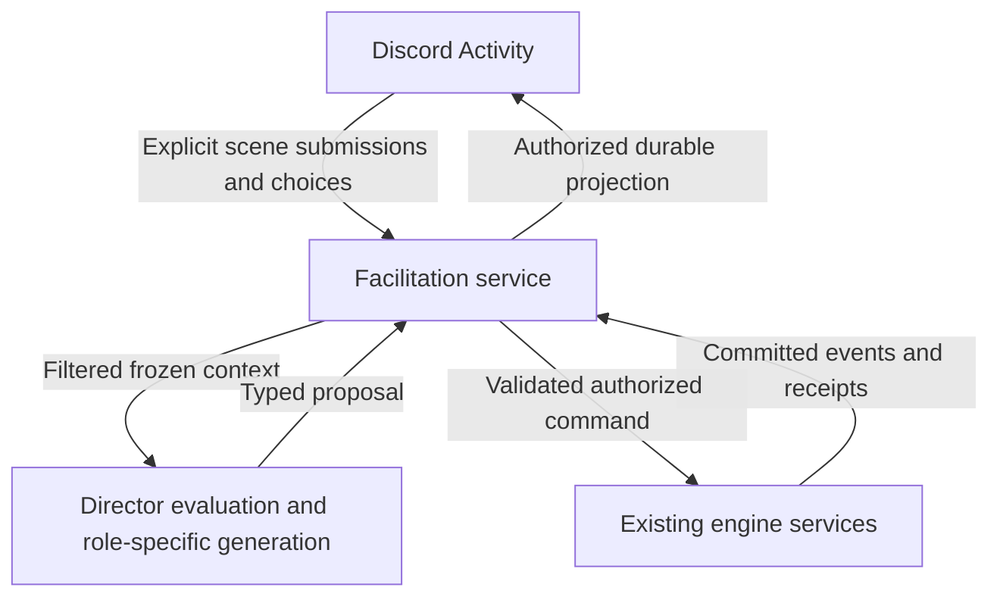

# AI Director — approved Activity-first architecture

Status: approved product/design specification; runtime integration is not complete.
Reconciled against source `28937b43fea63ac4df36260a330b55ebc6f39fb8` and the owner's
**GIRLFRAME / HarpyEngine: AI Director Architecture and Development Handoff**.
This document adapts its Discord conversation transport to the Discord Activity.
The retained original planning package and its hashes remain unchanged.

Subsequent implementation: [P2-D1](work_orders/P2_DIRECTOR_OBSERVATION.md) now
provides synthetic-only observation, durable eligible batches and one proved native
Keep Your Head trigger. See [actual evidence](../reports/P2_DIRECTOR_OBSERVATION.md).
This does not implement real observation, model decisions or live autonomy.

The owner's newer transport direction supersedes channel/thread observation in
the supplied handoff. Its settled pacing, capability and authority decisions are
preserved; references below distinguish planned seams from implemented methods.

The Director is the asynchronous AI GM/coordinator described here. The in-fiction
Director mechanics already present in the rules are separate and retain their
own actor/source requirements. The AI Handler remains a distinct fictional role.

## 1. Adopted decisions and activation boundary

**Option C is selected: selective observation with batched decisions.** Explicit
requests and relevant committed engine events complement conversation batching.
Ambient conversation has no routine per-message inference, unchanged-scene polling
or runtime agent swarm.
GM, NPC and Handler responsibilities use separate authorized contexts and, when
needed, separate calls. Development staffing follows the existing workflow.

Latest owner clarification: the GM handles adjudication and Play/response routing
with broad campaign knowledge; the Handler supplies only information within its
fictional knowledge. The implemented synthetic direct-request adapter calls the
GM first for each explicit request, then independently calls the Handler when
addressed. This direct path bypasses the routine quiet window. Handler input is
built from its actual appointed role, never from GM output or the GM envelope.
See [the current engine contract](P2_ENGINE_TRIAL_HANDOFF.md#discrete-gm-and-handler-conversation).

Subsequent owner correction for long-scene tests: Handler output is gated by an
engine RESPOND/WAIT decision, not a preselected turn or response quota. The
synthetic `process_message` seam now implements that separate decision before
generation, including one role-known scope-conflict warning. Broader initiative
and live publication remain unimplemented.

The synthetic GM now distinguishes visible intervention from private routine
review. Explicit Play requests yield typed referrals; actual native Keep workflows
still require their owner choices. A new receipt-proved GM completion readback
exposes only total/tier/dice/provenance, never private Handler outcome text. The
`--plays` long-scene trial demonstrates those paths without activating live mode.

Latest owner clarification: every Play needs an appropriate contextual GM response,
not merely a receipt/tier readback. Keep's actual positive/negative traits must be
judged against the attempted goal. The new adjudication proposal does that before
native confirmation, with reasoned success/failure or clarification. This bounded
synthetic adapter covers concrete endurance/control situations; other Play families
return an explicit need for their own printed-outcome adapter. The original
Handler-owner commit gate and role-scoped optional dialogue remain separate.

**The scheduler decides when the AI looks; the AI decides whether intervention is
useful; application services and the engine decide what may legally occur.**
Observation is not intervention, and a decision is not permission to change canon.

| Setting | Approved value |
|---|---|
| Strategy / initiative | Selective observer / balanced |
| Quiet window | 120 seconds |
| Autonomous NPC dialogue | Enabled capability, subject to eligibility and activation gates |
| Proactive world-event proposals | Enabled capability, subject to validation and activation gates |
| Trigger on completed Plays / conversation batching | Enabled |
| Unchanged-scene polling / fictional advancement from real time alone | Disabled |
| Human choice substitution / engine authority bypass | Prohibited |

Initial adjustable pilot defaults are 20 distinct unreviewed messages, oldest
unreviewed age 10 minutes, minimum routine review interval 120 seconds per scene,
unsolicited contribution cooldown 10 minutes, one unsolicited contribution per
new-input episode, one concurrent decision per scene, and one semantic repair
attempt per invalid proposal. These values are approved starting settings, not
measured pacing results. Keep them explicit and versioned in future policy.

Runtime modes:

- **Off:** no Director inference or optional Director publication. Existing
  required mechanics and committed outcome delivery continue.
- **Shadow:** evaluate eligible input and record decisions without committing
  game effects or publishing interventions. Real-data collection and real model
  calls still require their own consent, privacy, provider and spending setup.
- **Live:** execute only implemented, authorized, validated capabilities under
  the installed autonomy policy. An enabled capability does not enable live mode.

Current development remains synthetic and offline; no Director worker is running.
This documentation does not activate observation, shadow inference, autonomous
publication, a provider, live migrations, deployment or a bot restart.

## 2. Reconciliation with actual implementation

| Existing component | What exists / reuse | What remains missing |
|---|---|---|
| `ai/{contracts,context,synthetic,activity}.py`, `services/ai_assistance.py` | Strict v1 public-reference summaries, deterministic provider, owner-private request/draft/approve/reject/reopen, revisions and command replay | No scene observation, five-way Director decision, freeform narration, mechanical application or network provider |
| `ai/observation.py`, `services/director_observation.py`, migration `0022` | Subsequent D1: synthetic IC inputs/edits, explicit self-consent, fake-clock eligibility, frozen leased batches, acknowledgement/restart and supported native Keep source | No real capture, installed observer, fictional knowledge grants, model evaluation or publication; other Play/child families blocked |
| `services/m2_game.py`, `database/m2_schema.py` | Bound scenes/participants, actions, receipts, choices, locks, canonical transactions, scoped inspection and delivery work | Channel-bound scene APIs need an Activity adapter; no generic Director completion hook is established |
| `services/m3_work.py`, `m3_scene_contexts` | Immutable original scene identity/binding, source-aware required work | No fictional chronology/knowledge journal for Director prompts |
| `services/onboarding.py`, campaign `events` / command inbox | One store, trusted membership/binding, atomic writes, audit and idempotency; D1 now adds observation/frontier/lease records in `0022` | Real retention/consent policy and wider Director consumers remain separate |
| `delivery/outbox.py`, `delivery/m2_worker.py` and specialized workers | Roll/action delivery, claim tokens, retry/recovery and native chat locks | Existing outboxes are receipt/action-shaped; no general Activity scene publication stream or Director delivery adapter |
| `scenes/`, `gm/`, `handler/` package roots | Reserved namespace docstrings | Their existence proves no Director implementation; working scene mechanics already live in services |
| Activity integration | Character-sheet file exchange and neutral assistance v1 contract | Activity repository, backend, verified session flow and direct connection remain unverified here |

The source checkpoint passed 101 focused CI tests in
[run 43791181002](https://github.com/heyitskat777-netizen/HarpyEngine/actions/runs/43791181002).
Those tests establish the bounded summary slice and its selected dependencies,
not this Director design. P1 human acceptance and broader coverage stay open.
Last verified live release remains frozen v0.1.4 at `fe47d7e`; process status was
not reverified. No existing rules or source/campaign approval is promoted.

## 3. Activity transport and service ownership

The facilitation service owns subscriptions, scheduling, frozen context, pending
proposals and routing. The engine owns mechanics/canon, dice, costs, consent and
player choices. The Activity owns presentation and explicit input. All persistent
campaign records remain in the existing authoritative store.

The Activity backend derives identity, guild membership and roles from verified
Discord authentication, then verifies scene participation and actor control.
An iframe launch, browser-selected scene, account ID or role flag is not proof.
Discord IDs remain strings on the wire; display current authorized nicknames.
An account's Pilot and Handler contexts remain separate even when both are legal.

Use the actual Activity backend framework once supplied. No HTTP route, OAuth
implementation, WebSocket or deployed Activity connection is asserted here.
Existing worker lifecycles, native fallback, OOC safety and recovery remain intact.

| Chat-oriented handoff concept | Activity-first interpretation |
|---|---|
| Observe an opted-in channel/thread | Subscribe to an authorized persisted Activity scene stream |
| Player Discord message | Explicit submitted IC scene message, accepted and identified by the server |
| Slash command or mention for attention | Ask Director / Ready / Continue action with a stable command key |
| Discord transcript/message frontier | Durable scene input sequence plus source revisions and generation |
| Channel/thread audience | Current backend scene membership, visibility and observation consent |
| Post an NPC/GM message | Commit the permitted scene contribution and expose an authorized projection |
| Ephemeral review/buttons | Durable private review/task panel, refreshed under current authorization |
| Discord delivery receipt | Stable contribution/projection ID; optional Discord mirror has separate retry status |

No privileged `MESSAGE_CONTENT`, Gateway transcript listener, history scan, DM
collection, unrelated channel capture or voice capture is introduced. A future
Discord bridge would need its own explicit scope and consent; it would preserve
source identity to prevent mirrored input/output from being counted twice.

Scene identity is the immutable engine scene ID, not an Activity instance, tab,
client session or channel ID. Resolve the existing scene/channel binding on the
server and retain the original bind event. A channel rebind or browser reload
cannot move historical observations/choices into a different scene. Opening the
Activity does not create a scene, join it or establish physical presence.

## 4. Observations, knowledge and chronology

Only authorized, opted-in scene inputs enter the Director observation journal.
Observation policy records scene subscription, permitted purpose/provider scope,
participant consent and their revisions. Unresolved policy blocks real capture;
an administrator toggle cannot manufacture participant consent.

Activity submissions carry bounded text and requested IC/OOC classification;
server verification supplies author, actor binding, campaign, scene, message ID,
revision, ordering, timestamps and allowed visibility. Browser claims cannot grant
access or promote a message into canonical truth. Unsent drafts, typing/presence,
delivery acknowledgements, system echoes, OOC material and AI/bot-origin outputs
are excluded from ordinary player-fiction batching.

Keep four independent questions explicit: who may read a record; which fictional
actors learned its content and how; which AI role may receive it; and whether its
claims are established canon. A player assertion, NPC statement or summary is not
an engine receipt. Knowledge grants require actual source-backed discovery or an
authorized explicit disclosure; public availability alone grants no fictional
knowledge. GM, each NPC, Handler, player/public and facilitator-review projections
are built separately. A GM review never forwards its private context to an NPC.

Store real commit time separately from fictional effective time, scene order and
causal prerequisites. Source corrections supersede prior claims explicitly;
backdated conflicts require authorized adjudication. Neither inactivity nor a
wall-clock timer advances fiction, moves an NPC or makes a deadline consequential.

An accepted edit creates a source revision and invalidates affected frozen runs.
A material eligible edit updates input generation/quiet deadline; it does not
turn one message into twenty distinct messages for the size threshold. Retraction
invalidates dependent context and follows the retention/redaction policy. Keep
minimal source references and redaction markers as permitted; append-only game
audit is not a promise to retain personal text or derived summaries forever.
Define collection, retention, deletion and summary invalidation before real text.

## 5. Batching and scheduling

Each new eligible player input resets the 120-second quiet deadline. Duplicate
delivery/replay of the same accepted revision does not reset it or increase counts.
For posts at 20:00:00, 20:00:40 and 20:01:10, routine quiet eligibility starts at
20:03:10. A new post at 20:02:30 moves it to 20:04:30.

A routine review requires new eligible input plus quiet/size/age eligibility and
the 120-second minimum routine interval. Size (20 distinct unreviewed messages)
or age (10 minutes) can permit observation-only review during continuous play.
These reviews do not authorize unsolicited output while conversation is active.
Required mechanical follow-ups and explicit requested replies use their existing
timing/workflow; they may bypass the routine delay, never safety or authority.

Each batch freezes a bounded contiguous frontier of unreviewed eligible inputs,
relevant deduplicated event triggers and a bounded recent tail. Include permitted
scene participants, location, fictional time, source facts, NPC goals, outstanding
choices/locks and existing Play receipts. Summaries are retrieval aids with source
references, never independent canon. Split oversized input or expose an explicit
blocked state; never advance beyond silently discarded unreviewed input.

`WAIT` consumes only the successfully reviewed frozen frontier/triggers. New input
arriving during evaluation remains unreviewed. A tick on an unchanged scene makes
no inference. Failed calls consume nothing. A previously deferred contribution
may be reconsidered once an actual recorded condition becomes eligible; this is
not permission to repeatedly ask the same question about an unchanged scene.

Unsolicited publication requires a suitable quiet moment, the 10-minute cooldown
and at most one contribution per new-input episode. An episode is new eligible
human input/relevant external engine work since the last consumed episode;
Director outputs, their mirrored copies and ticks never create a fresh episode.
Events caused by the Director's own intervention are not fresh unsolicited fuel;
mandatory source-backed consequences still route through their exact workflows.
Revalidate deferred output against newer conversation and current permissions.
Maximum one decision claim per scene; unrelated eligible scenes may progress.

## 6. Committed Play integration and legal action routing

Play integration is required, not an optional enhancement. A supported completed
Play trigger references the original campaign/action, committed outcome event and
existing receipt. Verify all mandatory choices/effects and source-specific child
work are resolved before treating that operation as complete. Opening a wizard,
a raw roll or a browser success assertion is insufficient. Trigger deduplication
survives replay/restart and never rerolls or reinterprets the existing result.

Use existing pending choices, source-work and scene locks. Offline players retain
their Heat, Flirt, voluntary dialogue/action and agreement choices. A Director
request for a player Play opens the authorized chooser/confirmation; it does not
execute for them. Actual GM/NPC-owned choices may route to that precise role only
when an implemented service permits it. Keep unsupported paths blocked/reviewable.

Other grounded triggers include explicit attention/ready requests, scene creation
or resumption, relevant committed mission changes and established fictional
obligations becoming eligible. A name mention proves neither presence nor knowledge.
The engine and required receipt/outcome delivery continue without a Director.

## 7. Director decisions, generation and validation

The five decision kinds are `WAIT`, `REQUEST_PLAY`, `NPC_DIALOGUE`,
`WORLD_EVENT_PROPOSAL` and `NEEDS_REVIEW`. Prefer player conversation and one
focused useful response. Silence alone supplies no reason to manufacture drama;
there are no quotas for complications, betrayal or conflict.

The evaluation policy is to be a fair, attentive GM: respond to a grounded need,
eligible committed result, established fact, obligation or actor objective; avoid
inventing player decisions/emotions/consent or consequences of absence; return
`WAIT` when intervention adds little or violates continuity/agency.

Server-owned run metadata includes run/campaign/scene IDs, input generation and
frontier, source revisions, state/policy/consent/visibility revisions, event
triggers, context/prompt versions and provider/model ID. The model cannot choose
or overwrite this envelope. A separate strict Director decision contract will
carry bounded `kind`, `reason_code`, `source_refs`, nullable `actor_id`/`rule_id`,
typed allowlisted `proposed_effects`, advisory `requires_player_choice` and bounded
`brief`. Recompute authority and required choices on the server. The existing
summary v1 contract remains unchanged; it is not a generic effects contract.

Evaluation may use GM-authorized facts, but role-specific generation receives only
the facts the speaking GM/NPC/Handler is permitted to use. Validate source support,
identity/control, rule implementation, location, chronology, pending choices,
current revisions, safety, visibility, consent and autonomy policy. Schema-valid
text is insufficient. Allow one bounded semantic repair, then preserve failure
or route it to an authorized reviewer; no endless retries or invented outcome.

NPC dialogue requires a present/reachable legitimately controlled NPC with a
grounded motive and actual knowledge. Do not invent relocation or disclosure to
make dialogue possible. Ordinary speech is not objective world truth. Orders,
commitments, disclosures and mechanically meaningful speech use their typed
workflows. Handler generation uses her actual sheet, known orders, personal agenda
and institutional obligations; GM-only secrets and Pilot choices stay excluded.

World-event proposals require causal sources, valid fictional timeframe, legal
entities/preconditions, audience, permitted capability and response opportunity.
Future autonomous harmless narration uses a narrow reviewed allowlist. Damage,
costs, custody, forced movement, discoveries and punishments require actual audited
operations. Approving today's OOC summary grants none of these capabilities.

## 8. Durable execution, safety and delivery

Reuse the one campaign store, transaction/command inbox, source work, pending
decisions and existing delivery patterns. Add only missing observation, scheduler
and run records. Scene state tracks eligible activity, input generation, oldest/
latest unreviewed input, reviewed frontier, pending triggers, quiet deadline,
mode/policy revision, running/lease status and last unsolicited contribution.
Runs track frozen input, decision/reason/sources, deferred/validation/failure state,
bounded usage metadata and committed contribution/effect/outbox references.

Use short transactions to claim/freeze and to validate/commit. Network inference
runs outside write transactions and outside UI/Gateway handlers. Leases and stable
execution keys prevent concurrent claims and duplicate effects. Recheck relevant
input, state, policy, consent, membership and safety before inference, validation
and final commitment. Changes invalidate affected results while retaining new
unreviewed input. Provider timeout/refusal/malformed/truncated output or restart
leaves recoverable pending work; no failed call consumes its frontier.

Commit accepted effects, proposal outcome and required publication work atomically.
For Activity output, use stable persisted contribution/projection IDs and authorized
refresh; a reconnect reconstructs saved output rather than generating it again.
Any push channel is a refresh hint and must respect its authorized audience.
The transport is pending the Activity handoff; do not assume an existing stream.
Receipt/action-bound Discord outboxes require explicit adapters or minimal typed
extension for new consumers, never dummy rolls/actions to force a message through.

Optional output rechecks current safety, consent, membership, knowledge/visibility
and scene eligibility at delivery/read. Pause invalidates in-flight optional
proposals and suppresses queued optional narration. Do not suppress mandatory
preexisting outcome delivery or alter the requester's pause/resume authority.
Off preserves committed canon. Discord mirrors remain at-least-once external
delivery; acknowledgement loss may duplicate a post, never effects/dice/spending.
Corrections reference the original outcome through the existing audited process.

Restart restores unread input, eligible jobs and pending choices, recovers expired
claims, checks stale proposals and avoids obsolete NPC speech. Never invent missing
conversation history. Model/tool access has no unrestricted SQL, shell, filesystem,
network or Discord-send authority. Player text is untrusted content, not commands.
Keep real transcripts, secrets, hidden reasoning and credentials out of public
source, fixtures, ordinary logs and telemetry. Record bounded reasons, not hidden
chain-of-thought.

## 9. Activity surfaces and operational controls

Players need a scene timeline with IC/OOC attribution, visible outcomes and their
owned pending choices; explicit Ask Director / Ready / Continue; and a clear
observation notice/consent state. Presentation distinguishes proposed fiction,
established outcomes and decisions awaiting someone. UI activity is not a Play.
Drafts, NPC statements and canonical results keep their provenance and status.

Facilitators need authorized controls for off/shadow/live, scene subscription,
capability toggles, initiative/pacing, next eligible review, pending/deferred/failed
work, coarse decision category, budget status and their permitted review queue.
Player status reveals only their permitted progress; NPC motives, GM reasoning
and another owner's private proposals are excluded. A facilitator role is not a
blanket override of private Pilot data. Reopen/refresh works across sessions;
closing an Activity tab does not erase consent history or pending work.

Before real inference, settle the provider/model, data-processing scope, bounded
context/output, hourly/daily campaign spending caps, usage/concurrency ceilings,
retention/deletion and player consent. The historical OpenAI Responses API
recommendation is not an installed provider choice. Verify supported model/SDK
interfaces when separately implementing transport. Local batching is distinct
from a provider's offline Batch API. Budget failures preserve manual operation.

## 10. Concrete integration seams

The following is an interface inventory, not a connected HTTP API. D1 now
implements its named synthetic subset in `DirectorObservationService`; later
seams still require their named consumers before code or schema is added.

| Seam | Existing anchor / planned operation | Authority and transaction boundary |
|---|---|---|
| Scene and identity | Existing `GameService.bind_scene`, `join_scene`, `scene_info`, `HandlerService.authorize`; future Activity session adapter | Resolve verified user/role/actor and stable scene binding; build a fresh permitted projection rather than forwarding raw internal scene data |
| Activity observation | D1 `append_scene_input` | Synthetic explicit submission, expected scene revision, stable command key, server-owned source identity, actor and consent/visibility snapshot; obey scene chat locks |
| Play trigger | Existing actions/receipts/choices/source-required-work; D1 `observe_committed_play` | Native Keep source only; verify actual final outcome/receipt/history, block children and unresolved scene work, deduplicate original identity; no browser completion flag |
| Structured GM adapter v2 | `GMAdapterService.evidence/frame/evaluate/private/view/confirm_keep`; `ai.gm_protocol` | Offline five ordinary native Plays, actual Disobey parent, facilitator-authored demands/prerequisites, provider-supplied judgment, validated evidence/coverage, original Keep controller confirmation with freshness checked inside its transaction; GM reasoning never becomes participant/Handler speech |
| All-Play review | `PlayCatalog`; `DirectorPlayReviewService.queue/gm/review/view/gm_work/owner_work/handler_work` | All 63 native identifiers and the inventoried source rules have referrals; declared Plays persist private GM triage; actual native choices/grants/inbox retain original decision owners; fictional Handler context excludes GM notes and OOC controller work; review neither implements a missing rule nor applies an outcome |
| Batch/recovery | D1 `claim_review`, `acknowledge_review`, `status` | Short claim/ack transactions, frozen frontier, injected clock, token-bound leases and scoped status; no model evaluation or publication |
| Context and inference | Existing public-reference builder for summary only; planned `build_role_context` and `evaluate_run` | Source-aware role projection, server-owned run envelope; network inference outside a writer transaction |
| Decision validation | Planned `validate_director_proposal` | Strict five-way contract plus current authority, rule/source/knowledge/chronology/choice/safety checks; at most one repair |
| Authorized commitment | Existing typed Play/choice/source services; future narrow `commit_director_proposal` router | Call the exact implemented operation with real actor, expected revisions and stable key; unsupported effect has no handler; never expose arbitrary `GameService.event` writes |
| Output/reopen | Existing roll/action outbox patterns; planned contribution projection and `refresh_scene` adapter | Atomically record permitted contributions and required publication work; fresh audience checks, stable IDs, optional output suppression and separate mirror delivery |

## 11. Integration sequence, ownership and acceptance

The current bounded adapter candidate and runnable manual-provider console are
documented in [the engine trial handoff](P2_ENGINE_TRIAL_HANDOFF.md) and
[playtest report](../reports/P2_GM_ADAPTER_PLAYTEST.md). Annotated fixture judgments
demonstrate the v2 contract; real language/model quality remains untested. The
older v1 keyword adjudicator remains an explicitly historical experiment.

Historical M4 scene coordination, M5 GM, M6 Handler and M7 private pilot labels in
the supplied handoff are retained as history, not new milestones or acceptance.
Current work belongs to separately authorized P2 preparation under the existing
P1/P2/P3 roadmap. Broader release, independent review and human gates persist.

1. **This checkpoint:** canonical design, Activity mapping, concrete seam inventory
   and [one bounded next work order](work_orders/P2_DIRECTOR_OBSERVATION.md).
2. **P2-D1, implemented synthetic scope:** AI-free Activity-shaped observation →
   durable eligible review batch, with native Keep Your Head source proof and
   restart/idempotency evidence. No worker is started or Activity route registered.
3. Later: source-aware fictional chronology/knowledge and shadow decisions using
   fake providers; `WAIT`, repair/failure and pacing review. No autonomous output.
4. Later: reviewed narrow GM/NPC capabilities, typed Play consumers, Activity
   publication and provider/usage gates before a separately enabled live trial.
5. Later: distinct Handler initiative and opted-in multiplayer pacing/continuity
   evaluation. Automated evidence never certifies fairness or player satisfaction.

| ID | Required eventual evidence |
|---|---|
| DIR-01 | 120-second deadline resets for new eligible input, not duplicate delivery |
| DIR-02 | One stable scene and authorized participant/audience scope per batch |
| DIR-03 | Size/age review during continuous input does not publish unsolicited output |
| DIR-04 | Supported completed Play triggers one review with its actual outcome/receipt |
| DIR-05 | Human choices and actual source/scene locks remain authoritative |
| DIR-06 | `WAIT` consumes only its frozen frontier; no unchanged-scene or AI-only loop |
| DIR-07 | Relevant new input/state/policy revisions invalidate stale proposals |
| DIR-08 | Safety/permission/consent changes suppress pending optional output |
| DIR-09 | Injection and GM secrets cannot bypass authority or leak across audiences |
| DIR-10 | Grounded permitted NPC/world actions work; unsupported effects/fake rolls reject |
| DIR-11 | Restart/retry/reconnect never duplicates mechanical effects or dice |
| DIR-12 | Provider/budget failures remain recoverable; non-AI mechanics continue |

Use synthetic fixtures and focused applicable static/migration/privacy/integrity
checks per work unit, preserving the final-candidate full gate. These are required
acceptance criteria, not executed tests or a certification claim.

The next work order names the minimal code/API scope; the existing
[Activity assistance handoff](../integrations/ai_assistance/INTEGRATION_HANDOFF.md)
remains the delivered summary contract. Actual frontend/backend/auth details block
direct Activity connection, not synthetic engine-side design and batching work.
